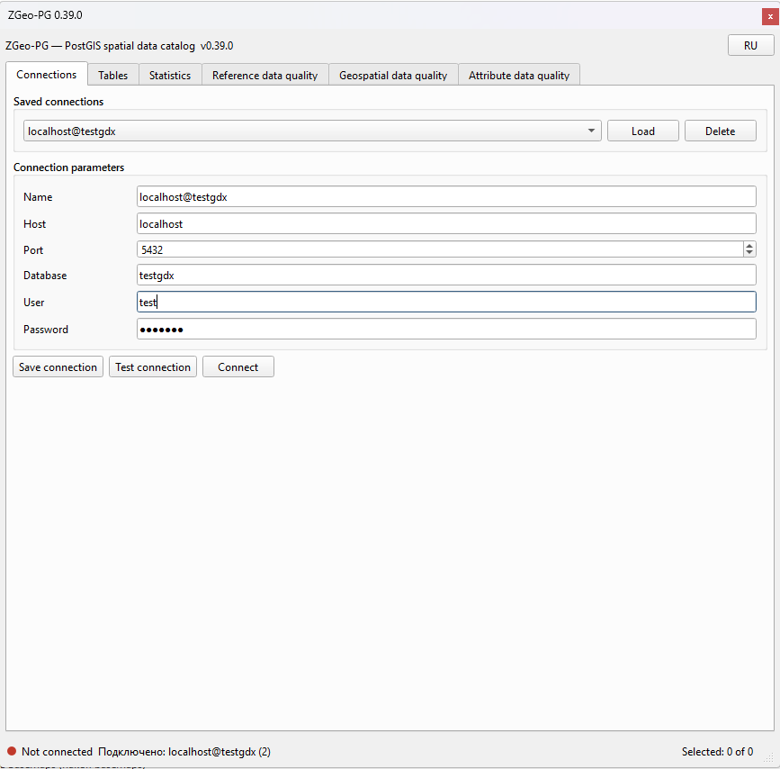
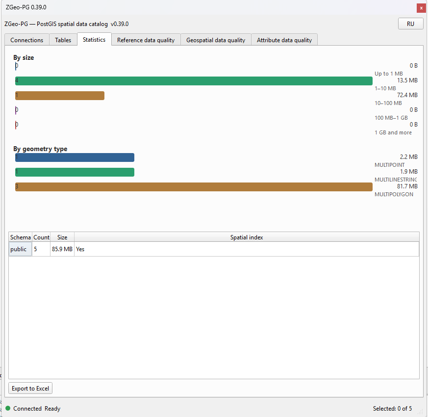
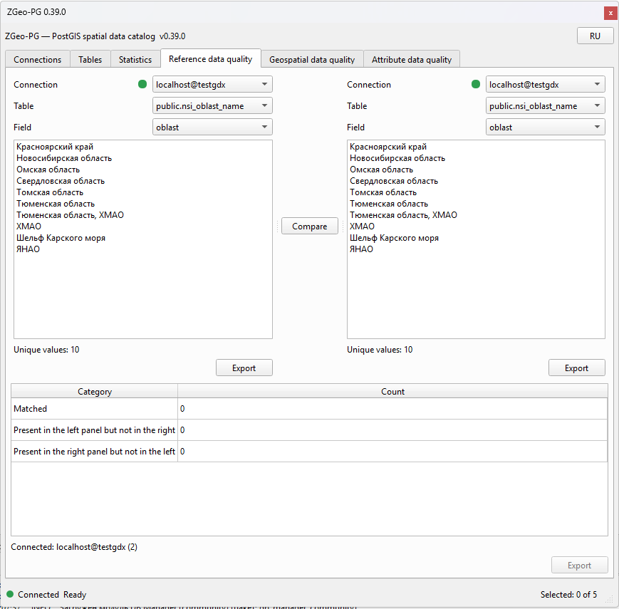
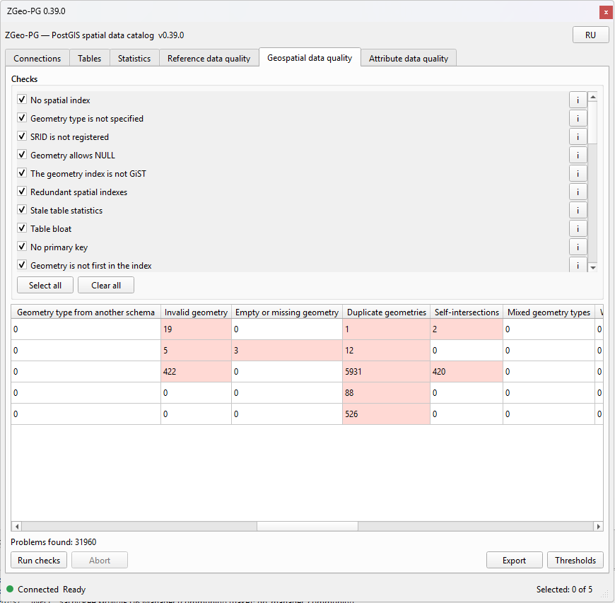
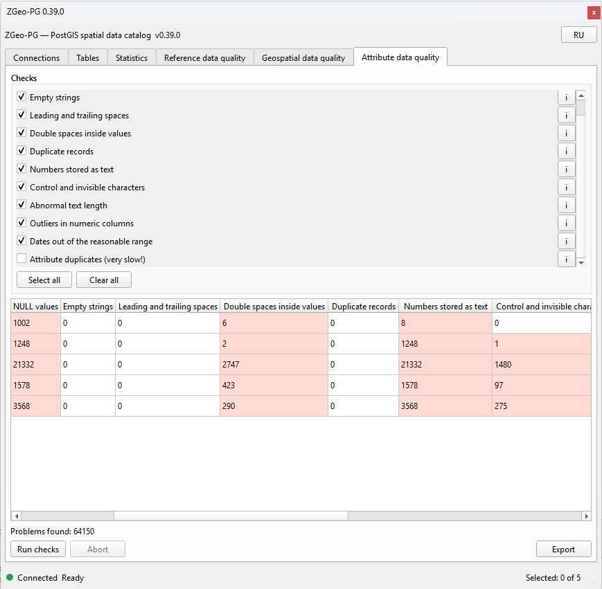

# ZGeo-PG

**Язык:** **Русский** | [English](README_eng.md)

Плагин QGIS для просмотра пространственных данных, хранящихся в базе PostgreSQL / PostGIS.

Версия плагина: **0.42.0**  
История изменений: [change.log](change.log)

Плагин добавляет в QGIS отдельную панель инструментов **«ZGeo-PG»** с кнопкой **«ZGeo-PG-Каталог»**, которая открывает плавающую панель. В панели:

- в верхней части отображается версия плагина;
- в правом верхнем углу панели кнопка **«EN» / «RU»** переключает интерфейс между английским и русским языками без перезапуска QGIS; выбранный язык сохраняется;
- на вкладке **«Подключения»** настраивается подключение к базе данных: хост, порт, имя базы, пользователь и пароль; кнопка «Сохранить соединение» пишет параметры и в настройки QGIS, и в локальную базу `<папка профиля QGIS>/zgeo-pg/connections.sqlite`, откуда они подхватываются при следующем запуске QGIS (форма заполняется последним соединением);
- там же кнопки «Подключиться» / «Отключиться»: нажатие «Загрузить» для сохранённого соединения сразу подключается к базе;
- в статусной строке слева зелёный кружок и надпись «Подключено», если соединение открыто, и красный с «Не подключено», если нет;
- в заголовке окна отображается текущая версия плагина;
- после подключения на вкладке **«Таблицы»** выводится список всех пространственных таблиц с названием схемы, таблицы, комментарием таблицы, столбцом геометрии, типом геометрии, SRID, оценочным количеством строк, точным количеством строк, размером данных и размером прочих индексов; далее — наличие пространственного индекса, его имя и размер, а в конце — «Полный размер» (данные + прочие индексы + пространственный индекс);
- значения количества строк и размера таблицы загружаются в фоновом режиме с возможностью прерывания; фоновая загрузка работает через отдельное соединение, поэтому кнопка «Обновить» перезагружает список без переподключения;
- над списком отображается фильтр по имени таблицы и выбор схемы; есть фильтр «Только с геометрией»;
- кнопка «Информация» на вкладке «Таблицы» открывает диалог с полными сведениями о выбранной таблице, включая комментарий и пространственный индекс;
- перед запуском сборки сохраните проект в QGIS: скрипт закрывает редактор, а если он не закрылся сам за 10 секунд — завершает процесс;
- кнопка «Экспорт» предлагает выбор «Экспорт в Excel» или «Экспорт в HTML»; в обоих форматах есть строка «Итого» с суммой по каждому числовому столбцу (оценка строк, точное количество объектов, размер данных, размер индексов, размер пространственного индекса, полный размер), а все размеры выводятся в человеко-читаемом виде — КБ, МБ, ГБ, ТБ;
- на вкладке **«Статистика»** отображаются диаграммы по размеру таблиц и по типу геометрии, а также таблица статистики по схемам;
- статистику также можно экспортировать в Excel или HTML — тоже с итоговой строкой;
- кнопки «Создать все пространственные индексы» (справа от «Экспорт») и «Обновить все пространственные индексы» (справа от неё) в панели вкладки «Таблицы»: первая строит GiST-индексы для всех таблиц без индекса, вторая перестраивает все существующие;
- в таблице схем на вкладке «Статистика» есть колонка «Пространственный индекс» (Да/Нет); меню по правой кнопке на строке схемы со значением «Нет» создаёт индексы для всех её таблиц;
- на вкладке **«Качество пространственных данных»** 37 проверок: сначала двенадцать мгновенных по каталогу PostGIS (тип геометрии не задан, SRID не зарегистрирован, геометрия допускает NULL, индекс не GiST, лишние пространственные индексы, устаревшая статистика, раздувание таблицы, нет первичного ключа, геометрия не первая в индексе, нет комментария к таблице, схема вне search_path, геометрия из чужой схемы), затем девять с одним проходом по таблице (самопересекающиеся линии, перепутаны широта и долгота, слишком много вершин, микрообъекты, лишняя размерность Z/M, коллекции геометрий, слишком много частей, очень крупная геометрия, дыры в полигонах, кольца против часовой стрелки, микролинии и дыры за пределами полигона), три тяжёлые проверки с соединением слоя с самим собой — пересечения полигонов внутри слоя, почти дубли геометрий по допуску и сливеры (узкие щели), они по умолчанию выключены, — и остальные прежние: невалидная геометрия, пустая геометрия, дубликаты, самопересечения, смешанные типы геометрии, неверный SRID, координаты вне диапазона, вырожденные объекты, незамкнутые кольца и отсутствие пространственного индекса; каждая проверка включается галочкой, кнопка «i» открывает справа описание проверки и способ исправления;
- проверки выполняются в фоновом потоке по всем загруженным таблицам; внизу вкладки кнопки «Проверить», «Прервать» и «Экспорт» (Excel или HTML); над статусной строкой показывается название текущей проверки, а в статусной строке — прогресс выполнения, результаты выводятся в таблицу «таблица × проверка» с подсветкой проблемных ячеек;
- на вкладке **«Качество атрибутивных данных»** такой же набор средств для 11 проверок атрибутов: пустые значения NULL, пустые строки, пробелы по краям, двойные пробелы, дублирующиеся записи, числа в текстовых столбцах, управляющие символы, аномальная длина текста, выбросы в числовых столбцах и даты вне разумного диапазона и «Дубли по атрибутам ( очень долго! )» — последняя по умолчанию выключена; последняя проверка объединяет полные дубли строк, дубли составного ключа, совпадения без учёта регистра и лишних пробелов и частичные вхождения с процентом вхождения (например, «ЯмалоНенецкий автономный окру» в «ЯмалоНенецкий автономный округ» — 96.7 %), а двойной щелчок по ячейке открывает подробный список с экспортом; проверки выполняются только по столбцам подходящего типа и показывают «Не применимо», если таких столбцов нет;
- на вкладке **«Качество по НСИ»** панель разделена на две части: слева и справа выбираются соединение, таблица и текстовое поле, ниже выводятся отсортированные списки уникальных значений; между панелями кнопка «Сравнить», под ней статистика «Совпало», «Есть в левой панели, но нет в правой», «Есть в правой, но нет в левой»;
- в таблице статистики меню по правой кнопке (и двойной клик по строке) открывает справа список значений выбранной категории, включая итоговую строку «Все из левой панели есть в правой» (её значение — только «Да» или «Нет», а список показывает значения, которых нет справа); каждая панель и результат сверки экспортируются в Excel или HTML: в Excel это лист «Статистика» и отдельный лист на каждую категорию («Совпало», «Есть в левой панели, но нет в правой», «Есть в правой, но нет в левой»), в HTML — одна страница, где сверху панель со ссылками, затем «Что выбрано» (соединение, таблица, поле каждой стороны), «Статистика» и таблицы со значениями по каждой категории;
- выбор строки в списке «Соединение» сразу подключает к ней, а слева от списка горит зелёная точка при успешном подключении и красная при ошибке (текст ошибки — в подсказке);
- если таблиц в списке нет, вкладка объясняет причину: «Подключено, но в базе нет таблиц» или «Подключено, но нет прав на чтение таблиц: <имя> (таблиц в базе: N)»;
- обе стороны вкладки НСИ видят текущее подключение панели, даже если оно не сохранено, и обновляют список соединений при подключении, сохранении и удалении; если база недоступна, показывается сообщение об ошибке, а вкладка остаётся рабочей;
- списки проверок на вкладках «Качество пространственных данных» и «Качество атрибутивных данных» прокручиваются, поэтому все проверки доступны и в невысокой панели, а кнопки «Выбрать все», «Сбросить все» и «По умолчанию» под списком отмечают все проверки, снимают все или возвращают выбор по умолчанию, справа от них показан счётчик «Выбрано 34/37»;
- на вкладке пространственных проверок меню по правой кнопке на ячейке таблицы результатов содержит пункт «Загрузить в текущий проект и выделить проблемные объекты»: таблица этой строки добавляется в проект QGIS слоем PostGIS, слой фильтруется по условию выбранной проверки, найденные объекты выделяются, а карта приближается к ним; нажатие на ячейку схемы или таблицы просто загружает слой целиком;
- кнопка «Пороги» на вкладке пространственных проверок задаёт максимум вершин, минимальную площадь полигона (плоскую и в м²), минимальную длину линии (плоскую и в метрах), допуск для почти дублей и максимальную площадь сливера (плоские и в метрах/м²), максимум частей, максимум размера геометрии и срок устаревания статистики; значения хранятся в настройках QGIS;
- названия, краткие и полные описания проверок и подсказки по исправлению переведены на английский и переключаются вместе с языком интерфейса, включая уже показанные результаты и открытое описание;
- меню по правой кнопке на строке списка таблиц: для «Нет» — «Создать пространственный индекс», для «Да» — «Обновить пространственный индекс» и «Удалить пространственный индекс» (с подтверждением).

## Скриншоты

**Вкладка «Подключения»** — параметры соединения, список сохранённых подключений и кнопки подключения.



**Вкладка «Таблицы»** — список пространственных таблиц с комментарием, SRID, размерами и пространственным индексом.



**Вкладка «Статистика»** — диаграммы по размеру и типу геометрии и статистика по схемам.



**Вкладка «Качество пространственных данных»** — 37 проверок с галочками, кнопками «i», «Выбрать все», «Сбросить все», «По умолчанию», «Пороги» и таблицей результатов.



**Вкладка «Качество атрибутивных данных»** — 11 проверок атрибутов с описанием проверки справа и подробным списком дублей по двойному щелчку.



Плагин поддерживает QGIS 3.16 и новее, включая QGIS 4 / Qt 6.

## Структура проекта

```text
zgeo-pg/
├── __init__.py          # точка входа classFactory
├── README.md            # документация на русском
├── README_eng.md        # документация на английском
├── metadata.txt         # метаданные плагина QGIS
├── change.log           # история изменений (английский)
├── plugin.py            # кнопка на панели инструментов и жизненный цикл панели
├── panel.py             # плавающая панель, список и вкладка статистики
├── i18n.py              # словарь переводов и переключение языка
├── connection.py        # подключения к PostgreSQL и локальная SQLite с параметрами
├── catalog.py           # чтение списка пространственных таблиц из PostGIS
├── stats.py             # агрегация таблиц для статистики
├── charts.py            # столбчатые диаграммы без внешних зависимостей
├── load_task.py         # фоновая загрузка характеристик таблиц
├── quality.py           # проверки качества пространственных и атрибутивных данных
├── nsi.py               # сверка НСИ: таблицы, поля и уникальные значения
├── info_dialog.py       # диалог «Информация о таблице»
├── explorer.py          # открытие файлов в проводнике
├── formatting.py        # форматирование размеров и чисел
├── excel_export.py      # запись таблиц в .xlsx без внешних зависимостей
├── html_export.py       # запись таблиц в .html без внешних зависимостей
├── table_export.py      # экспорт таблиц с выбором файла
├── version.py           # версия плагина из metadata.txt
├── icon.svg             # иконка плагина
├── img/                 # скриншоты интерфейса для документации (в архив не входят)
├── LICENSE.md           # лицензия MIT
├── scripts/             # скрипты сборки
└── .gitignore           # игнорируемые файлы
```

## Релиз

Порядок для каждой задачи:

1. поднять версию в `metadata.txt` на 1 и дописать строку в его `changelog`;
2. заполнить `change.log` на английском языке (новый раздел сверху);
3. обновить `README.md` и `README_eng.md`;
4. собрать и установить плагин скриптом `scripts\build_zip.ps1` — в `dist` останется только последний архив, а версия из него встанет в профиль QGIS 4.x (скрипт сам закрывает и заново открывает QGIS);
5. сделать коммит.

## Установка в QGIS

### Из ZIP-архива

Собрать архив:

```powershell
powershell -ExecutionPolicy Bypass -File .\scripts\build_zip.ps1
```

Готовый файл появится в `dist\zgeo-pg-0.42.0.zip`. В папке `dist` всегда остаётся только последняя сборка. Скрипт сначала закрывает запущенный QGIS Desktop (иначе он держит файлы плагина и копирование не проходит), устанавливает собранную версию в профиль QGIS Desktop 4.x (`%APPDATA%\QGIS\QGIS4\profiles\<профиль>\python\plugins\zgeo-pg`) и снова запускает QGIS. Для установки только архива добавьте `-SkipQGISInstall`, чтобы оставить QGIS закрытым — `-NoRestart`.

Либо установите вручную. В QGIS откройте:

**Плагины → Управление и установка плагинов → Установить из ZIP-архива**

и выберите собранный архив.

### Вручную

Скопируйте папку `zgeo-pg` целиком в каталог плагинов QGIS:

- Windows QGIS 4: `%APPDATA%\QGIS\QGIS4\profiles\default\python\plugins\`
- Windows QGIS 3: `%APPDATA%\QGIS\QGIS3\profiles\default\python\plugins\`
- Linux: `~/.local/share/QGIS/QGIS4/profiles/default/python/plugins/`
- macOS: `~/Library/Application Support/QGIS/QGIS4/profiles/default/python/plugins/`

Затем включите **ZGeo-PG** в менеджере плагинов QGIS.

После обновления плагина закройте QGIS полностью и запустите снова. Если панель **«ZGeo-PG»** не появилась, откройте **Плагины → Управление и установка плагинов**, найдите **ZGeo-PG** и убедитесь, что он включён.

## Использование

1. На панели инструментов **«ZGeo-PG»** нажмите кнопку **«ZGeo-PG-Каталог»** (или выберите **Плагины → ZGeo-PG → ZGeo-PG-Каталог**).
2. При необходимости переключите язык кнопкой **«EN» / «RU»** в правом верхнем углу панели.
3. Откройте вкладку **«Подключения»** и настройте подключение к базе данных PostgreSQL с расширением PostGIS.
4. Нажмите кнопку **«Подключиться»**.
5. После подключения на вкладке **«Таблицы»** появится список всех пространственных таблиц. Система координат, количество строк и размер таблицы загружаются автоматически в фоновом режиме.
6. Используйте фильтры для поиска таблиц по имени или выборки определённой схемы.
7. Выберите таблицу и нажмите кнопку **«Информация»** для просмотра подробных сведений.
8. Нажмите **«Экспорт»**, чтобы выгрузить список таблиц в Excel или HTML: размеры в файле выводятся в КБ/МБ/ГБ.
9. Откройте вкладку **«Статистика»** для просмотра диаграмм и статистики по схемам.

Последнее выбранное соединение запоминается и используется как стартовое при следующем запуске.

## Поддерживаемые версии

- QGIS 3.16 и новее
- PostgreSQL 12+ с расширением PostGIS 3.0+

## Требования

- В QGIS должен быть установлен драйвер QPSQL (входит в состав QGIS)
- В базе данных должно быть установлено расширение PostGIS
- Пользователь должен иметь права на чтение таблиц и системных представлений PostGIS

## Лицензия

MIT License — см. файл LICENSE.md

---

**Язык:** **Русский** | [English](README_eng.md)